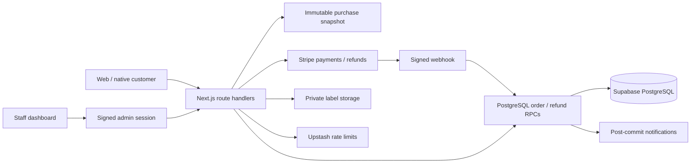

# Full-Stack E-Commerce & Order Management Platform

**Next.js · React · TypeScript · Supabase · PostgreSQL · Stripe**

[Live Site](https://kintampoafricanmarket.com) | [GitHub](https://github.com/richardeyeboah/kintampo-african-market)

A commerce application for Kintampo African Market, an African and Caribbean grocery store in Columbus, Ohio. Customers browse products, pay online, and track pickup or delivery. Staff manage catalog, phone orders, payment records, refunds, and fulfillment in one application.

The engineering focus is the boundary between **a successful payment and a complete, recoverable order**. The repository includes server-priced checkout, signed Stripe webhooks, transactional PostgreSQL order creation, durable refund operations, inventory allocation, and regression tests against an isolated PostgreSQL engine.

> The live site may run an earlier release. Changes requiring database migrations must pass staging verification before deployment. See [deployment requirements](docs/DATABASE.md) and [known limitations](docs/SECURITY.md).

## Product workflows

- Catalog browsing, search, categories, product variants, cart, accounts, addresses, wishlists, and reviews.
- Guest or account checkout with Stripe; pickup, local delivery eligibility, and shipping quotes.
- Staff catalog and stock tools, phone/WhatsApp order entry, unpaid/paid records, order status, and partial fulfillment.
- Receipts, pickup tickets, private shipping-label PDFs, and optional email/SMS notifications.
- Native SwiftUI clients in [`apple/`](apple/README.md); a separate Capacitor workspace in [`mobile/`](mobile/README.md).

## Engineering decisions

**Server-priced purchase snapshots.** The API aggregates duplicate cart lines, checks availability, calculates shipping and category tax, and stores the exact quote before creating a PaymentIntent. Payment fulfillment uses the purchased prices even if staff subsequently edit the catalog. Legacy snapshots without a quote have an explicit compatibility/reconciliation path.

**Atomic order creation.** The service-role-only `record_commerce_order` PostgreSQL function writes the header, items, inventory allocation, and initial event in one transaction. Payment-level locking and unique provider identifiers make duplicate webhook delivery safe. Historical header-only orders can be repaired by replaying fulfillment.

**Durable refund operations.** Staff refund requests carry a UUID idempotency key. A saved operation reserves the order's refund workflow; Stripe requests reuse the operation's provider key. Fulfilled quantities and accounting change only after the refund succeeds. Provider events or a retry reconcile pending operations. Full refunds update both the order status and its audit trail.

**Explicit inventory tradeoff.** Stock is allocated transactionally after payment, with no negative tracked quantity. A race that leaves insufficient stock creates a visible `inventory_review` order rather than hiding a paid purchase. This is not a pre-payment reservation system; staff must resolve shortages. See [architecture](docs/ARCHITECTURE.md).

**Restricted data access.** Customer reads use ownership policies. Admin pages and APIs use shared authorization checks. Refund RPCs and operation records are server-only. Customer tracking uses exact email matching, omits internal notes, and is rate limited. Shipping labels live in a private bucket with five-minute sharing links.

## Architecture



[Architecture and failure handling](docs/ARCHITECTURE.md) · [Database setup and upgrades](docs/DATABASE.md) · [Security and limitations](docs/SECURITY.md) · [Portfolio walkthrough](docs/PORTFOLIO.md)

## Local development

Use Node.js 22 and npm. Create a separate Supabase development project and Stripe test-mode credentials.

```bash
npm ci
cp .env.example .env.local
# Fill local values; keep this file private and ignored by Git.
npm run check:env
npm run dev
```

Open [localhost:3000](http://localhost:3000). See [environment setup](docs/ENVIRONMENT.md) before enabling integrations. Development servers connected to production services can still write production data; use dedicated development credentials.

## Verification

```bash
npm test             # Node regression tests + actual PostgreSQL RPC/RLS tests via PGlite
npm run test:logic   # Shipping, category-tax, refunds, receipts, pickup PDF logic
npm run typecheck
npm run lint
npm run ci           # Above checks + build using isolated placeholder configuration
npx playwright install chromium
node scripts/ci.mjs --browser # Also runs isolated checkout/admin browser smoke tests
```

The local verification pipeline runs regression and business-logic suites, type checking, lint, a production build, and checkout/admin browser smoke tests without live credentials. The current GitHub workflow still runs lint, type checking, and build; an expanded workflow is prepared locally but cannot be pushed by the connected app without GitHub workflow permission. PostgreSQL tests apply the checked-in migrations to an ephemeral database and simulate Supabase roles. They do not substitute for staging tests against hosted Supabase, Stripe, and storage.

`npm run test:e2e` runs the broader Playwright browser suite against a configured development environment. Address-provider tests require their own test credentials. A passing build alone does not verify payments or deployment configuration.

## Repository map

- `app/`, `components/` — storefront, account pages, staff tools, and server endpoints.
- `lib/orders/` — purchase snapshots, fulfillment, transaction adapter, and refund operations.
- `supabase/migrations/` — ordered baseline and additive upgrades.
- `scripts/tests/` — service-boundary regression and PostgreSQL integration tests.
- `tests/` — Playwright business-logic, PDF, and browser tests.
- `docs/` — architecture, operations, security, environment, and interview walkthrough.

Product, order, customer, credential, and payment data belong in configured services, never in Git. The project title describes the engineering application; the store retains its business identity.
